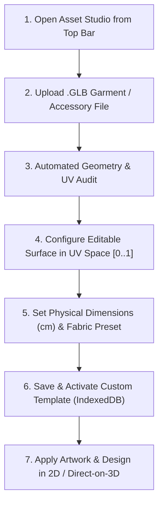

# CUSTOM 3D MODEL IMPORT & TEMPLATE WORKFLOW

**Feature:** Asset Studio (`src/components/panels/AssetStudioModal.tsx`, `src/services/modelValidator.ts`)

---

## 1. Overview

ThreadCraft allows users to import arbitrary 3D models (glTF/GLB) authored in Blender, Marvelous Designer, or Clo3D, configure their editable design zones interactively in UV space, and save them as reusable custom product templates stored locally in IndexedDB.

---

## 2. Step-by-Step Operator Workflow

### Step 1: Ingestion
Click **Asset Studio** in the TopBar. Drag and drop or upload any `.glb` or `.gltf` asset.

### Step 2: Automated Validation
The embedded `ModelValidator` immediately inspects the asset:
- Mesh count and vertex count (alerts if vertices exceed 500,000).
- Verifies that `attributes.uv` exists. Models lacking UVs are flagged with an actionable error.
- Verifies and computes vertex normals.
- Lists all detected material slots.

### Step 3: Interactive UV & Design-Zone Bounding
The operator visualizes the normalized UV unwrap grid $[0, 1] \times [0, 1]$ alongside the garment seam wireframe:
- Adjust **Position X ($U$)** and **Position Y ($V$)** sliders.
- Adjust **Width** and **Height** sliders to define the design surface bounds.
- Safe design boundary ($5\%$ inset) is automatically calculated.

### Step 4: Metadata & Material Configuration
- Assign product title (e.g. "Oversized Tactical Parka").
- Select category (`Apparel`, `Drinkware`, `Accessories`).
- Select default fabric preset (`Combed Cotton`, `French Terry`, `Duck Canvas`, `Chino Twill`, `Glazed Ceramic`).

### Step 5: Save & Activation
Click **Save & Activate Custom Product Template**:
- Record is persisted into Dexie IndexedDB (`db.customProducts`).
- The template immediately activates in the studio.
- Appears in the **Product Selector** under a **"CUSTOM TEMPLATE"** badge for future design sessions.
