# THREADCRAFT 3D STUDIO — PHASE 5: IMPLEMENTATION REPORT

**Evaluation Date:** November 20, 2026  
**Auditor:** Principal 3D Graphics Engineer, CAD Architect & QA Automation Engineer  
**Project Path:** `/Volumes/Disk D/artisan-3d-studio`

---

## 1. Feature Implementation Matrix

| Requirement | Scope | Status | Supporting Evidence |
|-------------|-------|:------:|---------------------|
| **1. Direct 3D Surface Dragging** | Hit-test, drag artwork directly on 3D mesh, lock orbit controls, sync to 2D canvas, undo/redo | **IMPLEMENTED** | Verified in `ProductRenderer.tsx` and Playwright test (`07_3d_direct_drag_verified.png`). |
| **2. Visual UV & Print-Zone Editor** | Interactive UV space [0..1], zone boundaries, design-safe margins, and seam wireframe | **IMPLEMENTED** | Built in `AssetStudioModal.tsx` and verified in Playwright test (`08_asset_studio_activated.png`). |
| **3. Custom GLB Product Template Pipeline** | Model import, hierarchy audit, custom product configuration, IndexedDB persistence | **IMPLEMENTED** | Built in `modelValidator.ts`, `db.customProducts`, and `ProductSelectorModal.tsx`. |
| **4. Realistic Rendering & PBR Materials** | Physically based materials, procedural micro-weave normals (Cotton, French Terry, Canvas, Ceramic Glaze), 3-point softbox studio lighting | **IMPLEMENTED** | Tested in `proceduralMaterials.ts`, `StudioScene.tsx`, and verified in WebGL 2 viewport. |
| **5. Advanced Design Engine** | Arched/circular typography, letter spacing, line height, magnetic snapping guides, layer drawer | **IMPLEMENTED** | Built in `curvedText.ts`, `FabricCanvas.tsx`, and `TransformBar.tsx`. |
| **6. Automated Verification** | Vitest unit/integration suite + Playwright E2E browser tests | **IMPLEMENTED** | **26/26 Unit Tests PASSED (543ms)**; **8/8 Playwright Tests PASSED (23.2s)**. |

---

## 2. Architecture Overview: The Triad Studios

With Phase 5, ThreadCraft is architecturally organized into three interconnected studios:

```mermaid
flowchart LR
    subgraph DesignStudio ["1. Design Studio (2D Vector Engine)"]
        Canvas2D["Fabric.js Canvas"]
        Tools["Typography, Arched Text, Shapes, Images"]
        Inspector["TransformBar & Layer Stack"]
    end

    subgraph ThreeStudio ["2. 3D Studio (WebGL PBR Engine)"]
        Scene3D["Three.js R3F Scene"]
        DirectDrag["Direct-on-3D Raycast Dragging"]
        Shaders["MeshPhysicalMaterial (Procedural Weaves)"]
    end

    subgraph AssetStudio ["3. Asset Studio (Model & UV Pipeline)"]
        GLBImport["GLB / glTF 2.0 Ingestion"]
        UVEditor["Interactive UV Space [0..1] Editor"]
        TemplateSaver["Custom Product Template Generator (IndexedDB)"]
    end

    AssetStudio -->|Custom Product Template| ThreeStudio
    DesignStudio <-->|Bidirectional SurfaceMapper| ThreeStudio
    AssetStudio -->|Print Zone Geometry| DesignStudio
```

